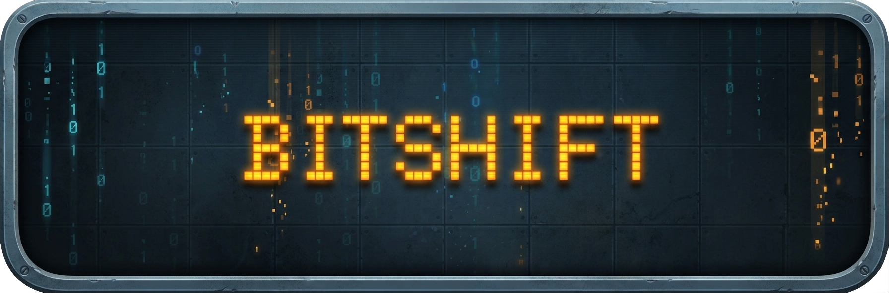
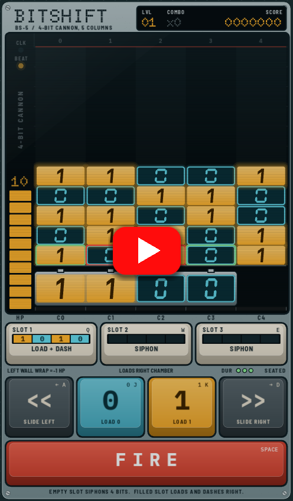
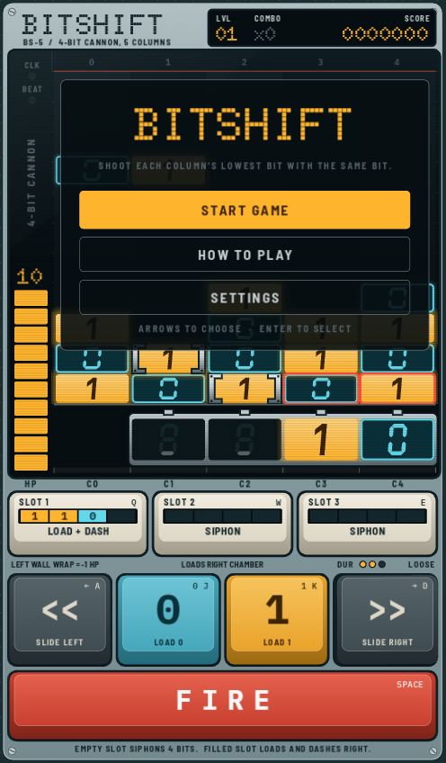
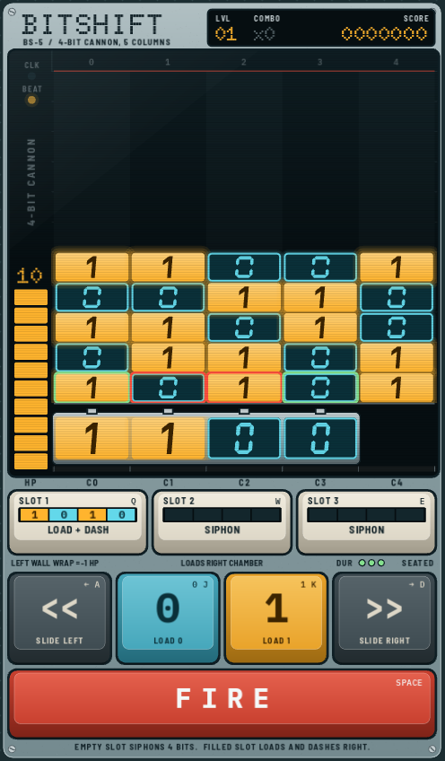
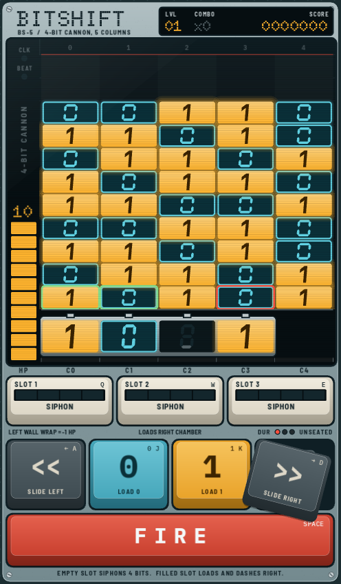
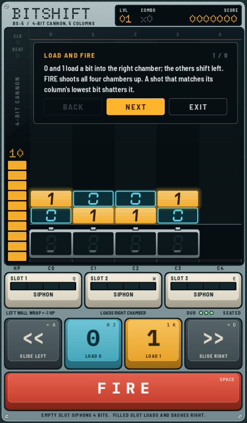
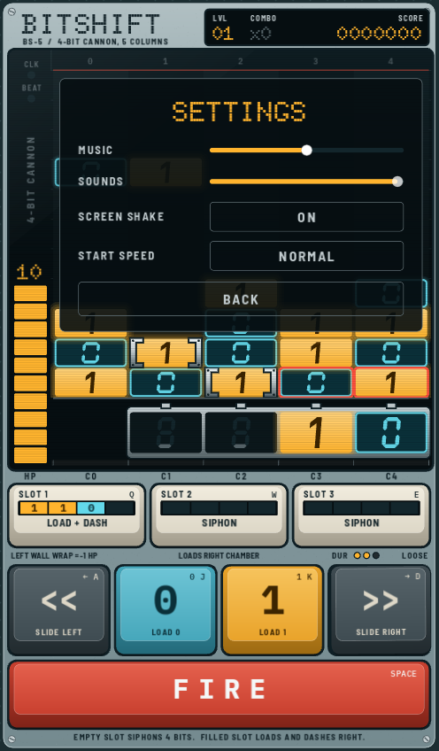

# BitShift

<p align="center">
  
  <br>
  <em>An arcade puzzle game styled as a 1970s laboratory test instrument.</em>
</p>

## Gameplay Demo

<p align="center">
  <a href="https://youtu.be/Nrycs1QVL5g">
    
  </a>
  <br><br>
  <a href="https://youtu.be/Nrycs1QVL5g">
    
  </a>
</p>

## Screenshots

<p align="center">
  
  
  
</p>

<p align="center">
  
  
</p>

## What is BitShift?

BitShift is an arcade puzzle game inspired by 1970s lab test equipment, oscilloscopes, and mechanical keyboards.

Columns of binary bits (`0` and `1`) drop from the top of an oscilloscope screen. You control a 4-chamber shift register cannon sliding along the bottom. Your goal is to shoot each column's lowest bit with a matching bit before any column piles up to the ceiling and triggers a **Stack Overflow**.

## Gameplay & Quirks

### The Shift Register Cannon
Loading bits works like real digital hardware:
- Pressing **0** or **1** clocks a new bit in from the right.
- Existing bits slide left. If all 4 chambers are full, the oldest bit drops out.
- Pressing **Space** fires all loaded chambers upward at once.

### Matching vs. Misfires
- **Match:** Hit a column with the same bit (`0` on `0`, `1` on `1`) to shatter it.
- **Mismatch:** The shot sticks to the bottom of the column, pushing the stack closer to the top.
- **Row Clears:** If an entire horizontal row across all 5 columns becomes the same bit, the whole row detonates for a score multiplier.

### The Broken Key
The machine's physical hardware wears down as you play:
- Sliding left (`<<`) is free and reliable.
- Sliding right (`>>`) wears out the mechanical switch. After 3 uses, the keycap flies off and breaks.
- To repair it, shoot green spare-switch bits (`*`) falling from the top.
- If you're stuck without a right key, you can slam the cannon into the far left wall to wrap around to the right side—costing 1 HP in sparks and scraping metal.

### Memory Slots & Superweapons
You have three clipboard slots (keys **Q**, **W**, **E**):
- **Siphon:** Pressing an empty slot sucks the bottom row of bits into memory.
- **Paste:** Pressing a filled slot pastes those bits back into your cannon.
  - Stacking matching bits transforms them into a **Laser** that cuts through up to 3 bits.
  - Stacking differing bits creates an **Inversion Beam** that flips all bits in that column.
  - Pasting also unleashes a 3-column **Recoil Dash** to the right, letting you move without wearing down your right key.

### Adaptive Procedural Audio
There are no audio sample files (`.wav` or `.mp3`) in the project. All sound effects and the background music arpeggio are synthesized in real-time using GDScript math formulas and a 4-bit Linear Feedback Shift Register (LFSR).

- **When safe:** A relaxed, chill groove at ~106 BPM.
- **When columns reach the danger zone (rows 8–11):** The music accelerates up to a frantic 170 BPM, bringing in heavy 4-on-the-floor kicks, driving basslines, and a high-pitched radar alarm synchronized with the flashing red ceiling band.

## Controls

| Action | Keyboard | Alternative | Mouse / Touch |
| :--- | :--- | :--- | :--- |
| Slide Left | `A` or `Left` | | Tap `<<` |
| Slide Right | `D` or `Right` | | Tap `>>` |
| Load 0 | `0` | `J` | Tap `0` |
| Load 1 | `1` | `K` | Tap `1` |
| Fire | `Space` | `Up` | Tap `FIRE` |
| Memory Slots | `Q`, `W`, `E` | | Tap Slots 1–3 |
| Pause | `P` or `Esc` | | |
| Start / Restart | `Enter` | | Tap Start |

## Tech & Setup

Built with **Godot 4.7** using the mobile renderer and custom CanvasItem drawing. 

Configured for single-threaded web export (no `SharedArrayBuffer` or COOP/COEP header requirements), allowing it to deploy directly to GitHub Pages via GitHub Actions.

### Running locally
1. Install [Godot 4.7+](https://godotengine.org/).
2. Open the project in Godot:
   ```bash
   godot --editor .
   ```
   Or launch directly:
   ```bash
   godot main/main.tscn
   ```

## Author

Created by Mathusan S.
