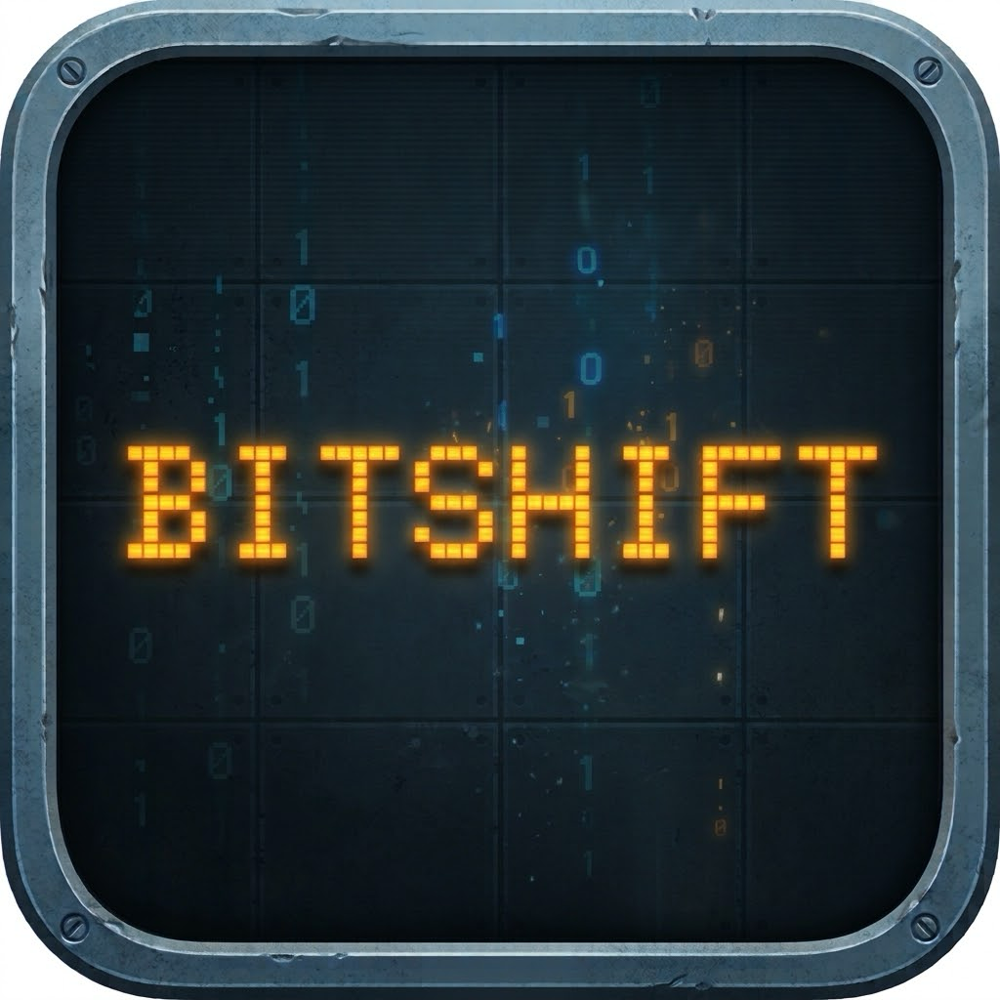

# BitShift (BS-5 Logic Cannon)

<p align="center">
  
</p>

<p align="center">
  <strong>A 1970s laboratory test bench instrument turned into a tactile arcade puzzle game.</strong>
</p>

<p align="center">
  
  
  
  
</p>

---

## 🕹️ Screenshots

<p align="center">
  
  
  
</p>

<p align="center">
  
  
</p>

---

## 📖 About The Game

**BitShift** places you in front of the **BS-5 Logic Cannon**—a heavy electronic laboratory instrument lying on an anti-static bench mat. Inspired by vintage oscilloscopes, logic analyzers, and mechanical keyboards, BitShift combines falling-block arcade puzzles with digital hardware logic.

Columns of binary bits (`0` and `1`) descend from the signal feed above the oscilloscope glass. Your objective: load bits into your 4-chamber shift register, aim under each column, and fire to destroy matching bits before the stack reaches the top ceiling and triggers a **STACK OVERFLOW**.

---

## ⚡ Core Mechanics

### 1. The Shift Register Cannon
Your cannon operates like real digital hardware (a 4-chamber FIFO shift register):
* Press **`0`** (or **J**) or **`1`** (or **K**) to clock in a bit from the right.
* Existing bits shift left. If the barrel is full (4 chambers), the leftmost bit spills out.
* Press **Space** or **Up** to fire all chambers upward into the board simultaneously.

### 2. Match to Destroy vs. Misfires
* **Match:** If your fired bit matches the bottom-most falling bit in that column, that bit **shatters**!
* **Mismatch (Misfire):** If the bits mismatch, your shot sticks to the bottom of the stack, growing the pile and bringing you one row closer to disaster.
* **Row Explosions:** When all 5 columns in a horizontal row contain the identical bit (`all 0s` or `all 1s`), the entire row detonates in a chain clear for bonus score.

### 3. Mechanical Key Wear & Durability
The BS-5 is an analog, physical machine—and it wears out:
* **Left Slide (`<<`):** Has infinite durability.
* **Right Slide (`>>`):** Mechanically degrades with every push!
  $$\text{Seated} \longrightarrow \text{Loose} \longrightarrow \text{Unseated} \longrightarrow \text{Broken}$$
  After 3 presses, the key switch breaks and pops off its stem!
* **Spare Switches:** Shoot green spare-switch bits (`*`) to drop fresh mechanical switches into your keyboard to repair the right key.

### 4. Left-Wall Bashing (Wrap-Around)
When your `>>` key is broken, how do you move right?
* Slamming your cannon hard into the **left wall** causes it to scrape, showering sparks and wrapping around to the far right wall.
* **Cost:** Wrapping the wall costs **1 HP**.

### 5. Memory Slots (Vacuum Siphon & Recoil Dash)
You have 3 memory clip slots (**Q**, **W**, **E**):
* **Vacuum Siphon:** Pressing an empty slot siphons the lowest row of bits directly above your cannon into memory.
* **Paste & Superweapons:** Pressing a filled slot pastes those bits into your cannon barrel:
  * Matching bits combine into a **Piercing Laser** (cuts through up to 3 bits).
  * Differing bits combine into an **Inversion Beam** (flips all bits in that column from `0` to `1` or `1` to `0`).
* **Recoil Dash:** Pasting a cartridge triggers a high-recoil blast that dashes the cannon 3 columns to the right without using `>>` key durability!

---

## 🎵 Dynamic Audio & "Stack Overflow" Alarm

BitShift contains **zero external audio files** (`.wav` or `.mp3`). Every sound effect, relay click, and musical arpeggio is synthesized mathematically in real-time using GDScript oscillators, noise filters, and a 4-bit Linear Feedback Shift Register (LFSR).

* **Chill Mode (Low Stack Height $\le 6$):**
  * Relaxed, steady tempo (~106 BPM) with warm, filtered basslines, gentle kicks, and spacious arpeggios.
* **Frenetic Panic Mode (Upcoming Stack Overflow, Rows 8–11):**
  * The music rapidly accelerates to **170+ BPM**!
  * Switches to an aggressive **hard kick**, four-on-the-floor driving beat, and rapid double-kick thumps.
  * Bass morphs into a gritty synthwave sawtooth chug.
  * **Ceiling Alarm:** A piercing high-register radar alarm (`alarm`) pings on alternating upbeats in sync with the pulsing red ceiling danger band, warning the player to **look up and clear the stack before overflow**.

---

## 🎮 Controls

| Action | Primary Key | Secondary Key | Touch / Mouse |
| :--- | :---: | :---: | :--- |
| **Slide Left** | <kbd>A</kbd> or <kbd>←</kbd> | | Tap `<<` keycap |
| **Slide Right** | <kbd>D</kbd> or <kbd>→</kbd> | | Tap `>>` keycap |
| **Load 0** | <kbd>0</kbd> | <kbd>J</kbd> | Tap `0` keycap |
| **Load 1** | <kbd>1</kbd> | <kbd>K</kbd> | Tap `1` keycap |
| **Fire Cannon** | <kbd>Space</kbd> | <kbd>↑</kbd> | Tap `FIRE` bar |
| **Memory Slots 1-3** | <kbd>Q</kbd>, <kbd>W</kbd>, <kbd>E</kbd> | | Tap Slot 1, 2, or 3 |
| **Start / Restart** | <kbd>Enter</kbd> | | Tap Start Button |
| **Pause Menu** | <kbd>P</kbd> | <kbd>Esc</kbd> | |
| **Toggle Music** | <kbd>N</kbd> | | Settings Menu |

---

## 🛠️ Architecture & Technology

```
bit-shift/
├── game/
│   ├── board/          # Instrument chassis, oscilloscope glass, camera shake
│   ├── field/          # Falling bit matrix, columns, wave spawner
│   ├── gun/            # 4-chamber shift register cannon, projectile logic
│   ├── keyboard/       # Mechanical switches, loose caps, durability states
│   ├── panel/          # CRT readout, LED clock/beat indicators, HP bar
│   ├── menu/           # Oscilloscope start menu and settings page
│   ├── tutorial/       # Interactive lessons with automated bot demo
│   └── fx/             # Particle bursts, laser beams, CRT phosphor flashes
├── audio/
│   ├── synth.gd        # Real-time mathematical wave synthesizer
│   └── audio_director.gd # Procedural LFSR arpeggiator & dynamic drum sequencer
├── main/
│   └── main.tscn       # Main entry scene
└── docs/screenshots/  # High-resolution in-engine captures
```

* **Engine:** Godot 4.7+ (Mobile Rendering method with MSAA 2D).
* **Deterministic Logic:** Decoupled simulation clock and pure rule handlers.
* **Single-Threaded Web Export:** Configured with `thread_support=false` for compatibility across all modern browsers and GitHub Pages without requiring Cross-Origin Isolation headers.
* **Continuous Deployment:** Automated GitHub Actions workflow exports the game and deploys to GitHub Pages on every push to `main`.

---

## 🚀 Building & Running

### Prerequisites
* [Godot Engine 4.7+](https://godotengine.org/download)

### Run Locally
```bash
# Clone the repository
git clone git@github.com:mathusanm6/BitShift.git
cd BitShift

# Launch with Godot
godot --editor .
# Or run directly:
godot main/main.tscn
```

### Run Unit Tests
```bash
godot --headless --script res://tests/test_game.gd
```

---

## 👤 Credits

* **Game Design & Development:** Mathusan S.
* **Engine:** [Godot Engine](https://godotengine.org)
