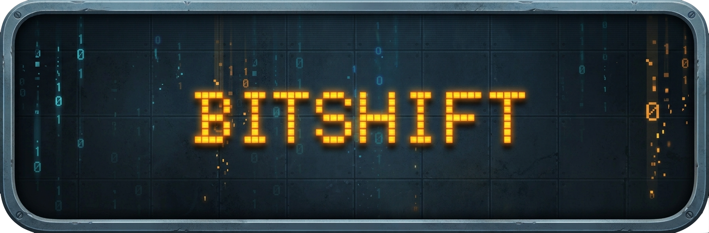
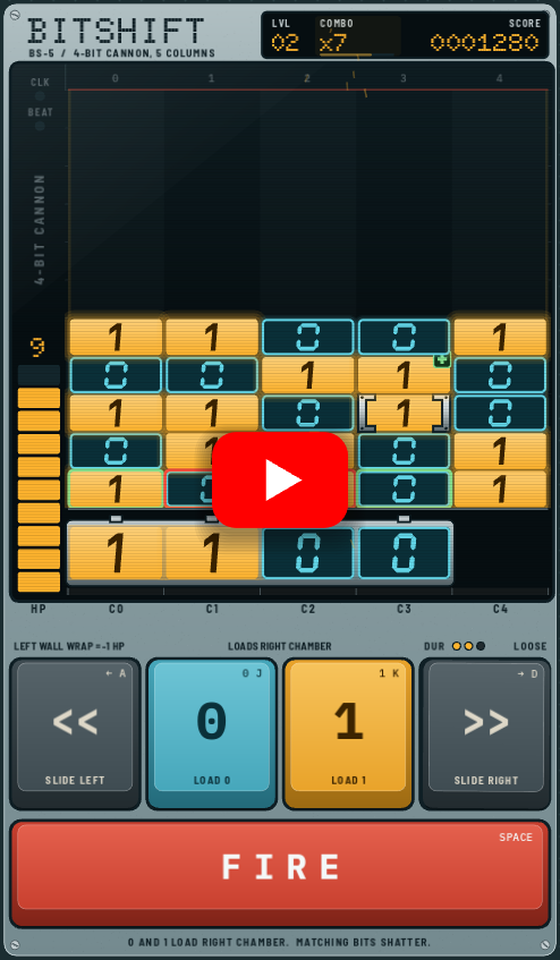
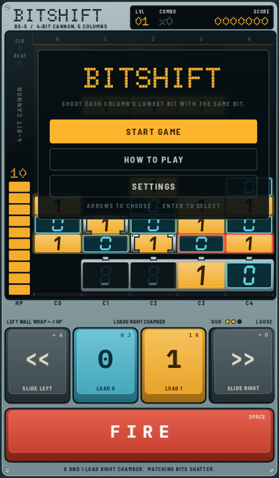
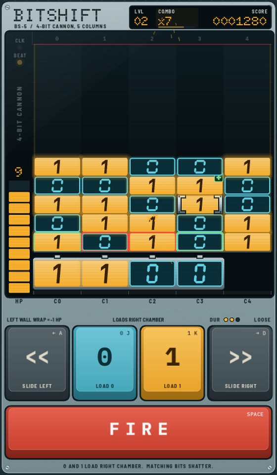
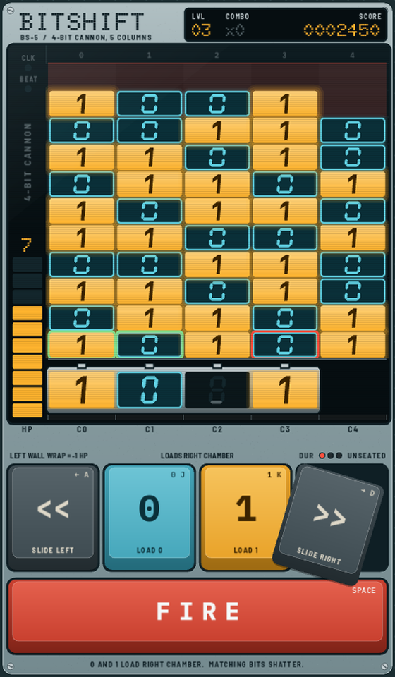
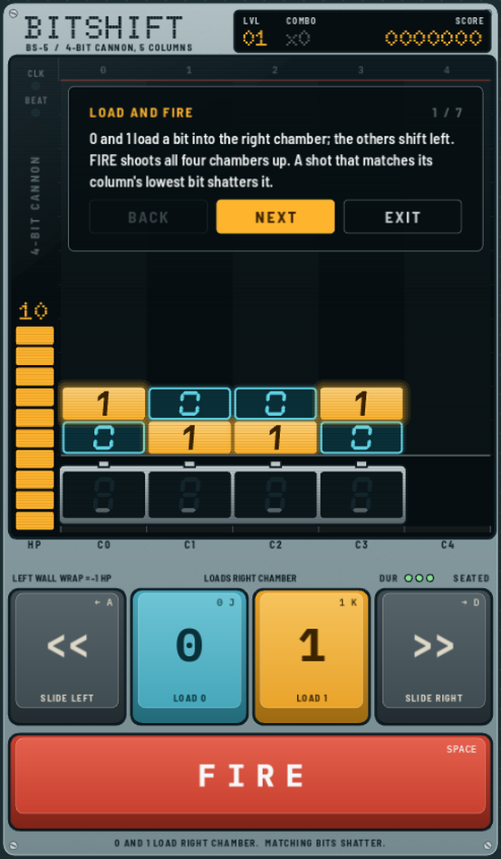
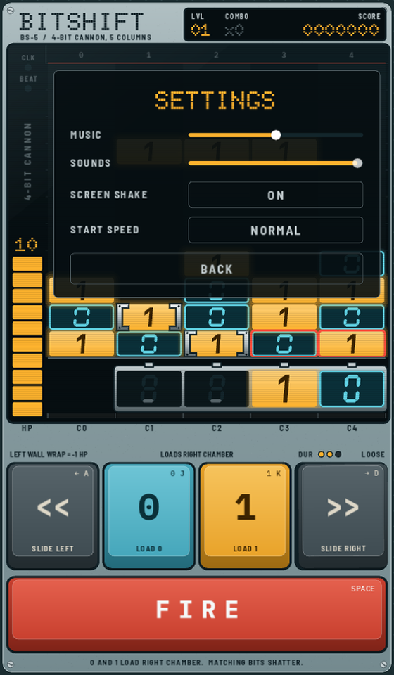

# BitShift

<p align="center">
  
  <br>
  <em>An arcade puzzle game styled as a 1970s laboratory test instrument.</em>
</p>

## Gameplay Demo

<p align="center">
  <a href="https://youtube.com/shorts/vmq11YgHP1I">
    
  </a>
  <br><br>
  <a href="https://youtube.com/shorts/vmq11YgHP1I">
    
  </a>
</p>

## Screenshots

<p align="center">
  
  
  
</p>

<p align="center">
  
  
</p>

## What is BitShift?

BitShift is an arcade puzzle game inspired by 1970s lab test equipment, oscilloscopes, and mechanical keyboards.

Columns of binary bits (`0` and `1`) drop from the top of an oscilloscope screen. You control a 4-chamber shift register cannon sliding along the bottom. Your goal is to shoot each column's lowest bit with a matching bit before any column piles up to the ceiling and triggers a **Stack Overflow**.

## Gameplay & Quirks

### The Shift Register Cannon
Loading bits works like real digital hardware:
- Pressing **0** or **1** clocks a new bit in from the right.
- Existing bits slide left. If all 4 chambers are full, the oldest bit drops out.
- Pressing **Space** fires all loaded chambers upward at once.

### Matching, Misfires & Locked Bits
- **Match:** Hit a column with the same bit (`0` on `0`, `1` on `1`) to shatter it.
- **Locked Bits:** Bits held in steel brackets take two matching shots—the first cracks the lock, the second shatters the bit.
- **Mismatch:** The shot sticks to the bottom of the column, pushing the stack closer to the top and breaking your combo.
- **Row Clears:** If an entire horizontal row across all 5 columns becomes the same bit, the whole row detonates for a big bonus—and cascading clears multiply as a chain.

### Combos & Streaks
Chaining clean hits without a misfire builds a live **Combo** multiplier:
- Every consecutive hit raises your score multiplier and escalates the oscilloscope's edge aura, readout glow, and synthesized pitch through color tiers (`x2`, `x5`, `x10+`).
- Big streaks trigger punchy hit-stop, screen shake, and milestone callouts.
- A single misfire snaps the streak back to `x0`.

### The Broken Key
The machine's physical hardware wears down as you play:
- Sliding left (`<<`) is free and reliable.
- Sliding right (`>>`) wears out the mechanical switch. After 3 uses, the keycap works loose and breaks off.
- To repair it, shoot bits carrying a green `+` spare-switch badge—the replacement flies in and restores 2 uses (or awards bonus points if the key is already intact).
- If you're stuck without a right key, slam the cannon past the far left edge: it smashes into the HP bar and bounces back to the right side, costing 1 HP in sparks and scraping metal.

### Adaptive Procedural Audio
There are no audio sample files (`.wav` or `.mp3`) in the project. All sound effects and the background music arpeggio are synthesized in real-time using GDScript math formulas and a 4-bit Linear Feedback Shift Register (LFSR).

- **When safe:** A relaxed, chill groove at ~106 BPM.
- **When columns reach the danger zone (rows 8–11):** The music accelerates up to a frantic 170 BPM, bringing in heavy 4-on-the-floor kicks, driving basslines, and a high-pitched radar alarm synchronized with the flashing red ceiling band.

## Controls

| Action | Keyboard | Alternative | Mouse / Touch |
| :--- | :--- | :--- | :--- |
| Slide Left | `A` or `Left` | | Tap `<<` |
| Slide Right | `D` or `Right` | | Tap `>>` |
| Load 0 | `0` | `J` | Tap `0` |
| Load 1 | `1` | `K` | Tap `1` |
| Fire | `Space` | `Up` | Tap `FIRE` |
| Toggle Music | `N` | | |
| Pause | `P` or `Esc` | | |
| Start / Restart | `Enter` | | Tap Start |

## Tech & Setup

Built with **Godot 4.7** using the mobile renderer and custom CanvasItem drawing. 

Configured for single-threaded web export (no `SharedArrayBuffer` or COOP/COEP header requirements), allowing it to deploy directly to GitHub Pages via GitHub Actions.

### Running locally
1. Install [Godot 4.7+](https://godotengine.org/).
2. Open the project in Godot:
   ```bash
   godot --editor .
   ```
   Or launch directly:
   ```bash
   godot main/main.tscn
   ```

## Author

Created by Mathusan S.
